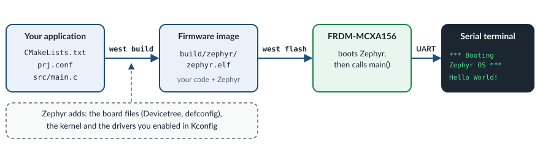

.. _exercise-hello-world:

Exercise 1: Hello Zephyr
========================

**Goal:** build your first Zephyr application, flash it to the FRDM-MCXA156 and
see its output on the serial console. Then change the message.

**Concepts:** Zephyr application structure, ``west``, board selection, the
build/flash process, the serial console.

**What you work on:**

.. list-table::
   :widths: 30 70

   * - Application folder
     - ``zs-zephyr/samples/hello_world``

   * - File you edit
     - ``zs-zephyr/samples/hello_world/src/main.c``

   * - Build command
     - ``west build -p -b frdm_mcxa156/mcxa156 zs-zephyr/samples/hello_world``

   * - Flash command
     - ``west flash``

.. include:: _include/before_you_start.rst

Anatomy of a Zephyr application
-------------------------------

A Zephyr application is a folder with at least three files. This is the
``hello_world`` application:

.. code-block:: none

   zs-zephyr/samples/hello_world/
   ├── CMakeLists.txt   <- tells CMake "this is a Zephyr app" and lists the sources
   ├── prj.conf         <- Kconfig options: which kernel features and drivers to enable
   └── src/
       └── main.c       <- your code: Zephyr calls main() after booting

Open each of the three files and read it. They are short:

.. code-block:: bash

   code zs-zephyr/samples/hello_world/CMakeLists.txt
   code zs-zephyr/samples/hello_world/prj.conf
   code zs-zephyr/samples/hello_world/src/main.c

What to look for:

- In ``CMakeLists.txt``, ``find_package(Zephyr ...)`` pulls in the whole
  Zephyr build system, and ``target_sources(app ...)`` adds your source file
  ``src/main.c`` to the application.
- ``prj.conf`` contains only a comment. That is fine: the board already ships
  sensible defaults, for example the serial console. They are in
  ``zs-zephyr/boards/nxp/frdm_mcxa156/frdm_mcxa156_defconfig``.
- In ``src/main.c``, Zephyr calls ``main()`` after the kernel has booted.
  ``main()`` runs in a normal **thread**, the *main thread*. When ``main()``
  returns, only the main thread ends. The kernel keeps running.
- ``main()`` prints ``CONFIG_BOARD_TARGET``. This is a text string with the
  name of the board you build for. It comes from Kconfig.

.. admonition:: Zephyr |zephyr_version| reference
   :class: seealso

   - :zdoc:`Application development <develop/application/index>`
   - :zdoc:`Hello World sample <samples/hello_world/README>`
   - :zkconfig:`CONFIG_BOARD_TARGET`

Build it
--------

This is the path from your source code to text on your screen:

In the terminal from `Before you start`_, run:

.. code-block:: bash

   west build -p -b frdm_mcxa156/mcxa156 zs-zephyr/samples/hello_world

What the parts of this command mean:

- ``west build``: build an application.
- ``-p``: make a **pristine** (clean) build. It deletes the previous build
  first.
- ``-b frdm_mcxa156/mcxa156``: the **board** to build for (and its SoC). Zephyr
  supports hundreds of boards, and the same source code builds for all of
  them. To see the boards whose name contains ``mcx``, run
  ``west boards -n mcx``.
- ``zs-zephyr/samples/hello_world``: the application folder.

The build takes up to a minute. The result goes into the ``build`` folder of
your work directory. The final program is ``build/zephyr/zephyr.elf`` (plus
``zephyr.hex`` and ``zephyr.bin``).

At the end of the build you get a memory usage report, similar to this:

.. code-block:: none

   Memory region         Used Size  Region Size  %age Used
              FLASH:       17756 B         1 MB      1.69%
                RAM:        4016 B       120 KB      3.27%

Write down your two numbers. You can compare them with the next exercises.

You will also see a few warnings during the build, for example:

.. code-block:: none

   warning: LPADC_DO_OFFSET_CALIBRATION (...) was assigned the value 'y' but got the value 'n'.
   Check these unsatisfied dependencies: ADC_MCUX_LPADC (=n), ADC (=n).

They are harmless. This one is a good first example of how Kconfig works:
the board's default configuration sets an ADC option, but the ADC driver is not
enabled in this application. Options have **dependencies**, and an option
whose dependencies are not met cannot be enabled.

.. admonition:: Zephyr |zephyr_version| reference
   :class: seealso

   - :zdoc:`Building, flashing and debugging with west <develop/west/build-flash-debug>`
   - :zdoc:`FRDM-MCXA156 board <boards/nxp/frdm_mcxa156/doc/index>`
   - :zdoc:`Setting Kconfig options <build/kconfig/setting>`

Flash it and look at the console
--------------------------------

Check that the serial console from step 3 of `Before you start`_ is open. Then,
in the first terminal, run:

.. code-block:: bash

   west flash

``west flash`` writes the last build to the board. It uses the board's default
*runner*, which is LinkServer for this board.

In the serial console you should see the Zephyr boot banner, followed by the
output of ``main()``:

.. code-block:: none

   *** Booting Zephyr OS build v4.4.2 ***
   Hello World! frdm_mcxa156/mcxa156

If you see nothing, press the **RESET** button on the board.

.. admonition:: Zephyr |zephyr_version| reference
   :class: seealso

   - :zdoc:`Flash and debug host tools (LinkServer) <develop/flash_debug/host-tools>`

Your task: print your own message
---------------------------------

Open the file:

.. code-block:: bash

   code zs-zephyr/samples/hello_world/src/main.c

1. In ``main()``, find (**Ctrl+F**) the text ``Hello World!`` and change it to
   ``Hello Zephyr! Running on``. Change only the text between the quotes. The
   line must now be:

   .. code-block:: c

      printf("Hello Zephyr! Running on %s\n", CONFIG_BOARD_TARGET);

   Keep the ``%s``: ``printf()`` replaces it with the value of
   ``CONFIG_BOARD_TARGET``. Keep the ``\n``: it starts a new line.

2. Save the file (**Ctrl+S**).

3. Rebuild and flash. You don't need ``-p`` and the board name now:
   ``west build`` without arguments rebuilds the same application as last
   time, and only recompiles what changed.

   .. code-block:: bash

      west build
      west flash

4. The serial console shows:

   .. code-block:: none

      *** Booting Zephyr OS build v4.4.2 ***
      Hello Zephyr! Running on frdm_mcxa156/mcxa156

Going further
-------------

**Look at the final configuration.** Open the file that lists every Kconfig
option of your build, with its value:

.. code-block:: bash

   code build/zephyr/.config

Press **Ctrl+F** and search for ``CONFIG_PRINTK``, then for
``CONFIG_SERIAL``. Both are ``=y`` (enabled).

**Browse all options interactively.** Run:

.. code-block:: bash

   west build -t menuconfig

Use the arrow keys to move and **Enter** to open a menu. Press **/** to
search. Press **Esc** to go back, and **Q** to quit. If it asks whether to save
the configuration, answer **No**.

**See what takes up flash.** Run:

.. code-block:: bash

   west build -t rom_report

It prints a tree of all the code in your program and its size.

.. admonition:: Zephyr |zephyr_version| reference
   :class: seealso

   - :zdoc:`Interactive Kconfig interfaces (menuconfig) <build/kconfig/menuconfig>`
   - :zdoc:`Optimization tools (rom_report) <develop/optimizations/tools>`
   - :zkconfig:`CONFIG_PRINTK`, :zkconfig:`CONFIG_SERIAL`

Discussion
----------

- What does ``west`` do, and what does CMake do? (``west`` is a meta-tool: it
  manages the workspace repositories and wraps CMake, Ninja and the flash and
  debug tools.)
- Why does the same ``main.c`` build for many different boards?

Start over
----------

To undo all your changes in ``zs-zephyr/samples/hello_world`` and get the original
files back, run these two commands in your work directory:

.. code-block:: bash

   git -C zs-zephyr checkout -- samples/hello_world
   git -C zs-zephyr clean -fd -- samples/hello_world

The first command restores the files that came with Zephyr. The second
one deletes the files that you **created** in that folder, for example an
overlay file.

.. warning::

   These commands cannot be undone. All your changes in
   ``zs-zephyr/samples/hello_world`` are lost, and the files you created there are
   deleted. If you want to keep your work, copy the folder somewhere else
   first.

.. include:: _include/troubleshooting.rst
