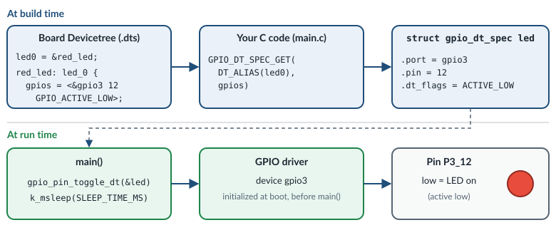

.. _exercise-blinky:

Exercise 2: Blinky
==================

**Goal:** blink the red LED on the board, then change the blink speed and the
color.

**Concepts:** GPIO, basic Devicetree (``led0``, ``gpio_dt_spec``), Kconfig and
``prj.conf``, the Zephyr device model.

**What you work on:**

.. list-table::
   :widths: 30 70

   * - Application folder
     - ``zs-zephyr/samples/basic/blinky``

   * - File you edit
     - ``zs-zephyr/samples/basic/blinky/src/main.c``

   * - Build command
     - ``west build -p -b frdm_mcxa156/mcxa156 zs-zephyr/samples/basic/blinky``

   * - Flash command
     - ``west flash``

.. include:: _include/before_you_start.rst

Build and flash it first
------------------------

In the terminal from `Before you start`_, run:

.. code-block:: bash

   west build -p -b frdm_mcxa156/mcxa156 zs-zephyr/samples/basic/blinky
   west flash

Keep the ``-p``: it cleans the ``build`` folder, which may still contain
another application from a previous exercise.

The red LED blinks: one second on, one second off. The serial console prints:

.. code-block:: none

   LED state: OFF
   LED state: ON
   LED state: OFF

Now open the source file. Keep it open while you read the next sections:

.. code-block:: bash

   code zs-zephyr/samples/basic/blinky/src/main.c

.. admonition:: Zephyr |zephyr_version| reference
   :class: seealso

   - :zdoc:`Blinky sample <samples/basic/blinky/README>`

Where does "the LED" come from? Devicetree
------------------------------------------

The C code does not say "port 3, pin 12". Instead, the hardware of the board is
described in **Devicetree** files, and the code refers to it by name. Open the
Devicetree file of the board:

.. code-block:: bash

   code zs-zephyr/boards/nxp/frdm_mcxa156/frdm_mcxa156.dts

Search (**Ctrl+F**) for ``aliases {``. Inside this block you find:

.. code-block:: dts

   led0 = &red_led;
   led1 = &green_led;
   led2 = &blue_led;

Now search for ``red_led:``. You find the description of the red LED, inside
the ``leds`` block:

.. code-block:: dts

   red_led: led_0 {
           gpios = <&gpio3 12 GPIO_ACTIVE_LOW>;
           label = "Red LED";
   };

- ``led0`` is an **alias**: a standard name that many Zephyr samples use.
  ``led0 = &red_led`` means "``led0`` is the node with the label
  ``red_led``". On another board, ``led0`` points to a different pin, and the
  same C code still works.
- ``gpios = <&gpio3 12 GPIO_ACTIVE_LOW>`` means: GPIO controller ``gpio3``,
  pin 12, and the LED is *on* when the pin is *low*. Zephyr handles the
  inversion for you: in your code, "1" always means "active" (LED on).
- The green (``green_led``) and blue (``blue_led``) LEDs are described just
  below, in the same way.

You don't change this file. Close it.

At build time, the Devicetree is turned into C macros. Go back to
``main.c``, near the top of the file:

- ``#define LED0_NODE DT_ALIAS(led0)`` finds the Devicetree node that the
  alias ``led0`` points to.
- ``static const struct gpio_dt_spec led = GPIO_DT_SPEC_GET(LED0_NODE, gpios);``
  reads its ``gpios`` property and stores it in the variable ``led``.

A ``struct gpio_dt_spec`` bundles everything the GPIO API needs: the GPIO
controller **device** (``led.port``), the pin number (``led.pin``) and the
flags (``led.dt_flags``, for example active low).

.. admonition:: Zephyr |zephyr_version| reference
   :class: seealso

   - :zdoc:`Devicetree guide <build/dts/index>`
   - :zdoc:`Syntax and structure <build/dts/intro-syntax-structure>`
   - :zdoc:`Devicetree access from C/C++ <build/dts/api-usage>`
   - :zapi:`DT_ALIAS() and node identifiers <devicetree-generic-id>`

The device model
----------------

In Zephyr, every driver instance is a ``const struct device``. Drivers are
initialized automatically at boot, before ``main()`` runs. Before you use a
device, check that its initialization succeeded. Look at ``main()`` in
``main.c``, from top to bottom:

1. ``gpio_is_ready_dt(&led)`` checks that the GPIO driver of the LED is ready.
2. ``gpio_pin_configure_dt(&led, GPIO_OUTPUT_ACTIVE)`` configures the pin as an
   output, and turns the LED on (``ACTIVE``).
3. The ``while (1)`` loop runs forever: ``gpio_pin_toggle_dt(&led)`` toggles
   the LED, ``printf()`` prints its state, and ``k_msleep(SLEEP_TIME_MS)``
   sleeps.

All functions ending in ``_dt`` take a ``gpio_dt_spec``. Most of them return
``0`` on success and a negative error code on failure. The code stores it in
``ret`` and checks it with ``if (ret < 0)``.

Putting it together: the Devicetree decides *which* pin, the build turns it
into a ``gpio_dt_spec``, and at run time the GPIO driver drives the pin:

.. admonition:: Zephyr |zephyr_version| reference
   :class: seealso

   - :zdoc:`Device driver model <kernel/drivers/index>`
   - :zapi:`Device model API <device__model>`
   - :zapi:`GPIO API <gpio__interface>` (``gpio_is_ready_dt()``, ``gpio_pin_configure_dt()``, ``gpio_pin_toggle_dt()``)
   - :zapi:`Thread APIs <thread__apis>` (``k_msleep()``)

Kconfig: enabling the GPIO driver
---------------------------------

Drivers are only compiled in if they are enabled in Kconfig. Open the
configuration file of the application:

.. code-block:: bash

   code zs-zephyr/samples/basic/blinky/prj.conf

It contains ``CONFIG_GPIO=y``. This enables the GPIO subsystem. On this board
it happens to be enabled by default already, but it is good practice to write
in ``prj.conf`` what your application needs.

.. admonition:: Zephyr |zephyr_version| reference
   :class: seealso

   - :zdoc:`Configuration system (Kconfig) <build/kconfig/index>`
   - :zdoc:`Devicetree versus Kconfig <build/dts/dt-vs-kconfig>`
   - :zkconfig:`CONFIG_GPIO`

Your tasks
----------

All tasks edit ``zs-zephyr/samples/basic/blinky/src/main.c``. Open it if it is not
open yet:

.. code-block:: bash

   code zs-zephyr/samples/basic/blinky/src/main.c

Do the tasks in order. After each task, save (**Ctrl+S**), then run:

.. code-block:: bash

   west build
   west flash

Task 1: blink faster
~~~~~~~~~~~~~~~~~~~~

Change the blink period from 1000 ms to 200 ms.

1. Near the top of the file, find (**Ctrl+F**) ``#define SLEEP_TIME_MS``.
2. Change the number ``1000`` at the end of that line to ``200``:

   .. code-block:: c

      #define SLEEP_TIME_MS   200

3. Save, build and flash. ``SLEEP_TIME_MS`` is the time passed to
   ``k_msleep()`` in the loop, so the red LED now blinks five times faster.

Task 2: blink the green LED
~~~~~~~~~~~~~~~~~~~~~~~~~~~

The board Devicetree has the alias ``led1`` for the green LED (see
`Where does "the LED" come from? Devicetree`_).

1. Near the top of the file, find ``#define LED0_NODE DT_ALIAS(led0)`` and
   change ``led0`` to ``led1``:

   .. code-block:: c

      #define LED0_NODE DT_ALIAS(led1)

2. Save, build and flash. Now the **green** LED blinks. You changed only one
   word, and the code uses a different pin.

3. **Change it back** to ``DT_ALIAS(led0)``, save, build and flash. The red
   LED blinks again.

Going further
-------------

**Look at the generated Devicetree.** Open the final, merged Devicetree of
your build and search (**Ctrl+F**) for ``led_0``:

.. code-block:: bash

   code build/zephyr/zephyr.dts

Then open the C macros generated from it:

.. code-block:: bash

   code build/zephyr/include/generated/zephyr/devicetree_generated.h

**Change the hardware description with an overlay.** You can change the
Devicetree without touching the board files, with an *overlay* file in your
application folder. Here you make ``led0`` point to the blue LED:

1. Create a new file. This command opens an empty file in VS Code, and
   creates it when you save:

   .. code-block:: bash

      code zs-zephyr/samples/basic/blinky/boards/frdm_mcxa156.overlay

2. Type this content and save:

   .. code-block:: dts

      / {
              aliases {
                      led0 = &blue_led;
              };
      };

3. Rebuild. You **must** use ``-p`` here, because the build system only looks
   for new overlay files in a clean build:

   .. code-block:: bash

      west build -p -b frdm_mcxa156/mcxa156 zs-zephyr/samples/basic/blinky
      west flash

   The build output contains the line
   ``-- Found devicetree overlay: .../boards/frdm_mcxa156.overlay``.

4. The LED that was red is now **blue**. The C code still says ``led0``.

5. Delete the file ``zs-zephyr/samples/basic/blinky/boards/frdm_mcxa156.overlay``
   again and rebuild with ``-p``.

**Compare the memory usage.** Look at the ``FLASH:`` and ``RAM:`` lines at the
end of the build, and compare them with ``hello_world`` (exercise 1). The
difference is small. Why? Hint: open ``build/zephyr/.config`` and search for
``CONFIG_GPIO=``. Remember that this board enables GPIO by default, also for
``hello_world``.

.. admonition:: Zephyr |zephyr_version| reference
   :class: seealso

   - :zdoc:`Devicetree how-tos (overlays) <build/dts/howtos>`

Discussion
----------

- Why use ``led0`` instead of ``gpio3`` pin 12 directly?
- Why does ``gpio_pin_set_dt(&led, 1)`` turn on an LED that is wired active
  low?
- Why does ``main()`` check ``gpio_is_ready_dt()`` before using the LED?

Start over
----------

To undo all your changes in ``zs-zephyr/samples/basic/blinky`` and get the original
files back, run these two commands in your work directory:

.. code-block:: bash

   git -C zs-zephyr checkout -- samples/basic/blinky
   git -C zs-zephyr clean -fd -- samples/basic/blinky

The first command restores the files that came with Zephyr. The second
one deletes the files that you **created** in that folder, for example an
overlay file.

.. warning::

   These commands cannot be undone. All your changes in
   ``zs-zephyr/samples/basic/blinky`` are lost, and the files you created there are
   deleted. If you want to keep your work, copy the folder somewhere else
   first.

.. include:: _include/troubleshooting.rst
