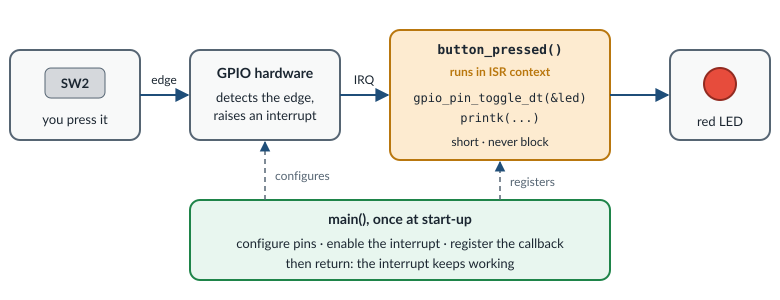

.. _exercise-button:

Exercise 3: Button + LED
========================

**Goal:** toggle the red LED each time you press button **SW2**, using an
interrupt instead of polling.

**Concepts:** GPIO input, interrupts, callbacks, ``sw0``/``led0``, ISR context.

**What you work on:**

.. list-table::
   :widths: 30 70

   * - Application folder
     - ``zephyr/samples/workshop/button``

   * - File you edit
     - ``zephyr/samples/workshop/button/src/main.c``

   * - Solution
     - ``zephyr/samples/workshop/button/solution/src/main.c``

   * - Build command
     - ``west build -p -b frdm_mcxa156/mcxa156 zephyr/samples/workshop/button``

   * - Flash command
     - ``west flash``

.. include:: _include/before_you_start.rst

Polling vs. interrupts
----------------------

You could read the button in a loop with ``gpio_pin_get_dt()``, but then the
CPU is busy checking it all the time, and you may miss short presses while you
sleep. Instead, we let the GPIO hardware raise an **interrupt** when the pin
changes, and Zephyr calls our **callback** function.

.. admonition:: Zephyr |zephyr_version| reference
   :class: seealso

   - :zdoc:`Interrupts <kernel/services/interrupts>`
   - :zdoc:`GPIO <hardware/peripherals/gpio>`

LEDs and buttons in Devicetree
------------------------------

The board's hardware is described in its **Devicetree** file,
``zephyr/boards/nxp/frdm_mcxa156/frdm_mcxa156.dts``. Open it and search
(**Ctrl+F**) for ``aliases {``. The aliases are standard names for board parts,
so your code does not need to know pin numbers:

- ``led0`` is the red LED (``red_led``).
- ``sw0`` is button SW2 (``user_button_2``).

Now search for ``user_button_2:``. You find the button, inside the
``gpio_keys`` block:

.. code-block:: dts

   user_button_2: button_2 {
           label = "User SW2";
           gpios = <&gpio1 7 GPIO_ACTIVE_LOW>;
           ...
   };

The button is on pin 7 of ``gpio1``, and it is *active low*: pressing it pulls
the pin to ground. Zephyr hides the inversion, so in your code "active" means
"pressed". You don't change this file. Close it.

In C, you get a ``struct gpio_dt_spec`` for an alias with
``GPIO_DT_SPEC_GET()``. This struct bundles everything the GPIO API needs: the
GPIO controller device, the pin number and the flags (for example active low).
All GPIO functions ending in ``_dt`` take a pointer to it:

.. code-block:: c

   static const struct gpio_dt_spec button = GPIO_DT_SPEC_GET(DT_ALIAS(sw0), gpios);

.. admonition:: Zephyr |zephyr_version| reference
   :class: seealso

   - :zdoc:`Devicetree access from C/C++ <build/dts/api-usage>`
   - :zapi:`Devicetree GPIO API <devicetree-gpio>`

Interrupt setup, step by step
-----------------------------

Setting up a button interrupt takes four calls:

.. code-block:: c

   /* 1. Configure the pin as an input */
   gpio_pin_configure_dt(&button, GPIO_INPUT);

   /* 2. Choose which event triggers the interrupt */
   gpio_pin_interrupt_configure_dt(&button, GPIO_INT_EDGE_TO_ACTIVE);

   /* 3. Prepare a callback structure (function + pin mask) ... */
   gpio_init_callback(&button_cb_data, button_pressed, BIT(button.pin));

   /* 4. ... and register it with the GPIO controller */
   gpio_add_callback_dt(&button, &button_cb_data);

``GPIO_INT_EDGE_TO_ACTIVE`` fires when the pin goes from inactive to active,
which means when the button is pressed. Other options are
``GPIO_INT_EDGE_TO_INACTIVE`` (release), ``GPIO_INT_EDGE_BOTH`` and
``GPIO_INT_LEVEL_ACTIVE``.

``button_cb_data`` is a ``static struct gpio_callback``. The GPIO driver keeps
a pointer to it, so it must stay in memory: never put it on the stack of a
function that returns.

The callback function must have this signature:

.. code-block:: c

   static void button_pressed(const struct device *dev, struct gpio_callback *cb,
                              uint32_t pins)

``pins`` is a bit mask of the pins that triggered the interrupt.

.. admonition:: Zephyr |zephyr_version| reference
   :class: seealso

   - :zapi:`GPIO API <gpio__interface>` (``gpio_pin_interrupt_configure_dt()``, ``gpio_init_callback()``, ``gpio_add_callback_dt()``, ``GPIO_INT_EDGE_TO_ACTIVE``)
   - :zapi:`Utility functions <sys-util>` (``BIT()``)

Your tasks
----------

Open the starter file:

.. code-block:: bash

   code zephyr/samples/workshop/button/src/main.c

It builds, but it only prints a message. It contains comments named
``Step 1`` to ``Step 6``. Each step below tells you where to add code,
relative to these comments. Don't delete the comments: they help you find
your place.

Step 1: the LED, the button and the callback structure
~~~~~~~~~~~~~~~~~~~~~~~~~~~~~~~~~~~~~~~~~~~~~~~~~~~~~~

Find the comment that starts with ``Step 1:``. **Below** the end of that
comment (the line with ``*/``), add an empty line and:

.. code-block:: c

   static const struct gpio_dt_spec led = GPIO_DT_SPEC_GET(DT_ALIAS(led0), gpios);
   static const struct gpio_dt_spec button = GPIO_DT_SPEC_GET(DT_ALIAS(sw0), gpios);

   static struct gpio_callback button_cb_data;

Step 2: the callback
~~~~~~~~~~~~~~~~~~~~

Find the comment that starts with ``Step 2:``. **Below** the end of that
comment, and **above** ``int main(void)``, write the function
``button_pressed()``. Use the signature from
`Interrupt setup, step by step`_. Inside the function:

1. Declare a press counter: ``static uint32_t press_count;``. The keyword
   ``static`` makes the variable keep its value between calls (it starts
   at 0).
2. Toggle the LED: ``gpio_pin_toggle_dt(&led);``.
3. Add 1 to the counter: ``press_count++;``.
4. Print the counter:
   ``printk("Button pressed %u times\n", press_count);``.

Steps 3 to 6: the setup in ``main()``
~~~~~~~~~~~~~~~~~~~~~~~~~~~~~~~~~~~~~

Inside ``main()`` there is one long comment that lists steps 3 to 6. Add the
code of all four steps **below** the end of that comment, and **above** the
line ``printk("Press SW2 to toggle the LED\n");``, in this order.

**Step 3.** Declare a variable for the return values, and check that both
devices are ready:

.. code-block:: c

   int ret;

   if (!gpio_is_ready_dt(&led) || !gpio_is_ready_dt(&button)) {
           printk("Error: GPIO device not ready\n");
           return 0;
   }

**Step 4.** Configure the LED as an output, off at the start
(``GPIO_OUTPUT_INACTIVE``), and check the result:

.. code-block:: c

   ret = gpio_pin_configure_dt(&led, GPIO_OUTPUT_INACTIVE);
   if (ret < 0) {
           printk("Error %d: failed to configure LED\n", ret);
           return 0;
   }

Then do the same for the button: call ``gpio_pin_configure_dt()`` with
``&button`` and ``GPIO_INPUT``, check ``ret`` and print
``Error %d: failed to configure button`` if it fails.

**Step 5.** Make the button raise an interrupt when it is pressed: call
``gpio_pin_interrupt_configure_dt()`` with ``&button`` and
``GPIO_INT_EDGE_TO_ACTIVE``. Check ``ret`` the same way.

**Step 6.** Bind your callback to the button pin and register it. Check the
return value of the second call the same way:

.. code-block:: c

   gpio_init_callback(&button_cb_data, button_pressed, BIT(button.pin));
   ret = gpio_add_callback_dt(&button, &button_cb_data);

Build and flash
~~~~~~~~~~~~~~~

Save (**Ctrl+S**), then:

.. code-block:: bash

   west build -p -b frdm_mcxa156/mcxa156 zephyr/samples/workshop/button
   west flash

Each press of SW2 toggles the red LED, and the console prints:

.. code-block:: none

   Press SW2 to toggle the LED
   Button pressed 1 times
   Button pressed 2 times

If it does not work, compare your file with the solution,
``zephyr/samples/workshop/button/solution/src/main.c``. You can also build
and flash the solution to see how it should behave:

.. code-block:: bash

   west build -p -b frdm_mcxa156/mcxa156 zephyr/samples/workshop/button/solution
   west flash

Then build your own version again with the build command from the table at
the top of this page (with ``-p``).

ISR context: what you must know
-------------------------------

Your callback runs **in interrupt context**, inside the ISR (interrupt service
routine), not in a thread. To see it, add this line at the end of
``button_pressed()``, then build and flash:

.. code-block:: c

   printk("in ISR: %s\n", k_is_in_isr() ? "yes" : "no");

Rules of thumb for code in an ISR:

- **Keep it short.** While it runs, no thread can run, and interrupts with the
  same or lower priority must wait.
- **Never block.** No ``k_msleep()``, no waiting on a semaphore or queue with
  a timeout, no mutexes. There is no thread to put to sleep.
- Only call APIs documented as *ISR-safe* ("isr-ok" in the API
  documentation), for example ``k_sem_give()``,
  ``k_msgq_put(..., K_NO_WAIT)`` or ``gpio_pin_toggle_dt()``.
- ``printk()`` works, but it is slow: it writes to the UART character by
  character. That is fine for learning, but not for real products.

**Try breaking the second rule:**

1. Open the configuration file:

   .. code-block:: bash

      code zephyr/samples/workshop/button/prj.conf

   Add this line at the end of the file and save:

   .. code-block:: none

      CONFIG_ASSERT=y

   ``CONFIG_ASSERT`` turns on extra checks inside the kernel.

2. In ``main.c``, add this line at the end of ``button_pressed()`` and save:

   .. code-block:: c

      k_msleep(100);

3. Run ``west build`` and ``west flash``, then press SW2. The console prints a
   message that starts with ``ASSERTION FAIL [!arch_is_in_isr()]``, followed
   by a fatal error report. The kernel caught your mistake and stopped.

4. Remove both lines again, save both files, and rebuild.

.. admonition:: Zephyr |zephyr_version| reference
   :class: seealso

   - :zdoc:`Interrupts <kernel/services/interrupts>`
   - :zapi:`Interrupt Service Routine APIs <isr__apis>` (``k_is_in_isr()``)
   - :zdoc:`Fatal errors and assertions <kernel/services/other/fatal>`
   - :zkconfig:`CONFIG_ASSERT`

Going further
-------------

- **Contact bounce.** Press the button many times. Does the counter sometimes
  jump by 2 or 3 on a single press? That is **contact bounce**: the
  mechanical contacts open and close several times within a few milliseconds.
  Exercise 4 shows how to filter it out.
- **LED on while the button is held.** In ``main()``, find
  ``GPIO_INT_EDGE_TO_ACTIVE`` and change it to ``GPIO_INT_EDGE_BOTH``: the
  callback now runs on press *and* on release. In ``button_pressed()``,
  replace ``gpio_pin_toggle_dt(&led);`` with:

  .. code-block:: c

     gpio_pin_set_dt(&led, gpio_pin_get_dt(&button));

  ``gpio_pin_get_dt()`` returns 1 while the button is pressed, and
  ``gpio_pin_set_dt()`` sets the LED to that value.
- **Second button.** Use the second button (alias ``sw1``, labeled SW3) to
  control the green LED (alias ``led1``). You need a second ``gpio_dt_spec``
  for each, a second ``static struct gpio_callback`` and a second callback
  function, and the same setup calls in ``main()``.

Discussion
----------

- Why should an ISR be short? What would happen if it took 100 ms?
- ``main()`` returns, but the button still works. Why?

Start over
----------

To undo all your changes in ``zephyr/samples/workshop/button`` and get the original
files back, run these two commands in your work directory:

.. code-block:: bash

   git -C zephyr checkout -- samples/workshop/button
   git -C zephyr clean -fd -- samples/workshop/button

The first command restores the files that came with Zephyr. The second
one deletes the files that you **created** in that folder, for example an
overlay file.

.. warning::

   These commands cannot be undone. All your changes in
   ``zephyr/samples/workshop/button`` are lost, and the files you created there are
   deleted. If you want to keep your work, copy the folder somewhere else
   first.

.. include:: _include/troubleshooting.rst
