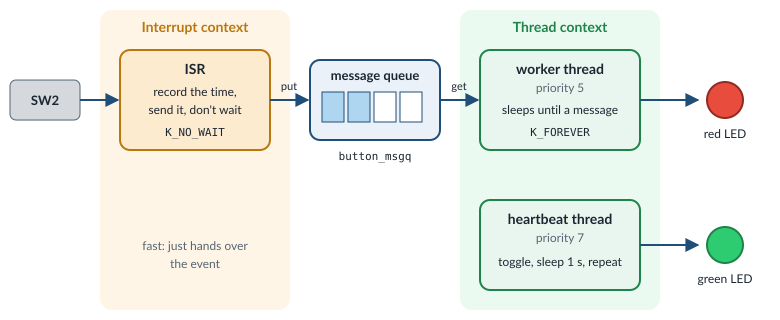

.. _exercise-threads:

Exercise 4: Threads
===================

**Goal:** start thinking like an RTOS developer. Move the application logic out
of the interrupt and into a thread:

**Concepts:** threads, priorities, message queues, blocking vs. non-blocking
calls, ISR vs. thread context.

**What you work on:**

.. list-table::
   :widths: 30 70

   * - Application folder
     - ``zephyr/samples/workshop/threads``

   * - File you edit
     - ``zephyr/samples/workshop/threads/src/main.c``

   * - Solution
     - ``zephyr/samples/workshop/threads/solution/src/main.c``

   * - Build command
     - ``west build -p -b frdm_mcxa156/mcxa156 zephyr/samples/workshop/threads``

   * - Flash command
     - ``west flash``

.. include:: _include/before_you_start.rst

What the starter already does
-----------------------------

The starter file already contains the code that sets up the hardware, so you
can focus on threads:

- ``led`` and ``button``: the red LED (alias ``led0``) and button SW2 (alias
  ``sw0``), both of type ``struct gpio_dt_spec``. This struct bundles what the
  GPIO API needs: the GPIO controller, the pin number and the flags.
- ``button_cb_data``: a ``static struct gpio_callback``, which registers the
  callback with the GPIO driver.
- ``button_pressed()``: the **callback**. Zephyr calls it when SW2 is
  pressed. It runs in **interrupt context** (inside an ISR, an interrupt
  service routine), not in a thread. Its body is empty: you fill it in.
- ``main()``: checks that the devices are ready, configures the LED as an
  output and the button as an input, enables the button interrupt and
  registers ``button_pressed()``. Then it returns. You don't change
  ``main()``.

The interrupt is configured with ``GPIO_INT_EDGE_BOTH``: unlike in exercise 3,
``button_pressed()`` runs when the button is pressed **and** when it is
released. You will see why in step 6.

Why not do everything in the ISR?
---------------------------------

An ISR could toggle the LED and call ``printk()`` directly. That works for a
tiny demo, but real work, like talking to a sensor, updating a display or
sending data, is too slow for an ISR. It often needs APIs that **block**,
which is not allowed in an ISR. The usual pattern is:

- the **ISR** records *what* happened (and *when*) and hands it over, without
  waiting;
- a **thread** waits for these events and does the actual work.

.. admonition:: Zephyr |zephyr_version| reference
   :class: seealso

   - :zdoc:`Interrupts: offloading ISR work <kernel/services/interrupts>`

Threads
-------

A thread is an independent flow of execution with its own stack and a
**priority**. The scheduler always runs the highest-priority thread that is
*ready*. A thread that waits (because it sleeps or waits on a queue) is not
ready and uses no CPU time.

The easiest way to create a thread is to define it statically. It starts
automatically after boot:

.. code-block:: c

   static void worker_thread(void *p1, void *p2, void *p3)
   {
           while (1) {
                   /* wait for work, then do it */
           }
   }

   K_THREAD_DEFINE(worker_tid, 1024, worker_thread, NULL, NULL, NULL,
                   5 /* priority */, 0 /* options */, 0 /* start delay */);

- **Lower number = higher priority.**
- Priorities ``>= 0`` are *preemptible*: when a higher-priority thread becomes
  ready, it interrupts them immediately. Negative priorities are
  *cooperative*: they run until they give up the CPU themselves.
- ``main()`` itself runs in a thread, with priority 0 by default.

In this exercise you write two threads: ``worker`` (priority 5) handles the
button, and ``heartbeat`` (priority 7) blinks the green LED on its own.

**Who runs first?** All three threads are ready right after boot. You might
worry that ``worker`` uses the LED before ``main()`` has configured it. It
does not, for two reasons:

- ``main()`` has priority 0, which is higher than 5 and 7. The scheduler runs
  ``main()`` first, and the other threads only get the CPU when ``main()``
  waits or returns.
- Even with other priorities, the code is safe. ``worker`` first waits on the
  queue, and the queue stays empty until ``main()`` enables the button
  interrupt. ``heartbeat`` configures its own LED before it uses it.

.. admonition:: Zephyr |zephyr_version| reference
   :class: seealso

   - :zdoc:`Threads <kernel/services/threads/index>`
   - :zdoc:`Scheduling <kernel/services/scheduling/index>`
   - :zdoc:`System threads (main thread) <kernel/services/threads/system_threads>`
   - :zapi:`Thread APIs <thread__apis>` (``K_THREAD_DEFINE``, ``k_msleep()``)
   - :zkconfig:`CONFIG_MAIN_THREAD_PRIORITY`

Message queues
--------------

A ``k_msgq`` is a thread-safe FIFO of fixed-size messages, copied by value:

.. code-block:: c

   struct button_event {
           uint32_t timestamp_ms;  /* when it happened */
           bool pressed;           /* true: pressed, false: released */
   };

   /* name, size of one message, max number of messages, alignment */
   K_MSGQ_DEFINE(button_msgq, sizeof(struct button_event), 8, 4);

   k_msgq_put(&button_msgq, &evt, K_NO_WAIT);  /* producer (ISR) */
   k_msgq_get(&button_msgq, &evt, K_FOREVER);  /* consumer (thread) */

The last argument is the **timeout**. It decides whether the call blocks:

.. list-table::
   :header-rows: 1
   :widths: 20 55 25

   * - Timeout
     - Behavior
     - Allowed in an ISR?

   * - ``K_NO_WAIT``
     - Return immediately, with an error if not possible
     - yes

   * - ``K_MSEC(100)``
     - Wait at most 100 ms, then return ``-EAGAIN``
     - no

   * - ``K_FOREVER``
     - Wait as long as it takes
     - no

.. admonition:: Zephyr |zephyr_version| reference
   :class: seealso

   - :zdoc:`Message queues <kernel/services/data_passing/message_queues>`
   - :zapi:`Message Queue APIs <msgq__apis>` (``K_MSGQ_DEFINE``, ``k_msgq_put()``, ``k_msgq_get()``)
   - :zapi:`System Clock APIs <clock__apis>` (``K_NO_WAIT``, ``K_MSEC()``, ``K_FOREVER``)

Your tasks
----------

Open the starter file:

.. code-block:: bash

   code zephyr/samples/workshop/threads/src/main.c

Besides the setup described in `What the starter already does`_, the starter
contains the thread priorities (``WORKER_PRIORITY``, ``HEARTBEAT_PRIORITY``),
the stack size (``STACK_SIZE``) and ``DEBOUNCE_MS``, and comments named
``Step 1`` to ``Step 5``. Each step below tells you where to add code,
relative to these comments. Don't delete the comments.

Step 1: the message queue
~~~~~~~~~~~~~~~~~~~~~~~~~

Find the comment that starts with ``Step 1:``. **Below** the end of that
comment (the line with ``*/``), add the message type ``struct button_event``
and the queue ``button_msgq``, exactly as shown in the comment and in
`Message queues`_.

Step 2: the ISR
~~~~~~~~~~~~~~~

Go to the function ``button_pressed()``. Inside it, find the comment that
starts with ``Step 2:``. **Below** the end of that comment, and above the
closing ``}`` of the function, add the code that records the event:

.. code-block:: c

   struct button_event evt = {
           .timestamp_ms = k_uptime_get_32(),
           .pressed = (gpio_pin_get_dt(&button) == 1),
   };

   k_msgq_put(&button_msgq, &evt, K_NO_WAIT);

``k_uptime_get_32()`` returns the time since boot in milliseconds.
``gpio_pin_get_dt()`` reads the button: ``1`` means pressed. It is ISR-safe.
The ISR does not toggle the LED: the worker thread does that. If the queue is
full, ``k_msgq_put()`` returns an error and the event is lost. We ignore that
for now.

.. admonition:: Zephyr |zephyr_version| reference
   :class: seealso

   - :zapi:`System Clock APIs <clock__apis>` (``k_uptime_get_32()``)
   - :zapi:`GPIO API <gpio__interface>` (``gpio_pin_get_dt()``)

Step 3: the worker thread
~~~~~~~~~~~~~~~~~~~~~~~~~

Find the comment that starts with ``Step 3:``. **Below** the end of that
comment, write the function ``worker_thread()``. Use the signature from the
comment: ``static void worker_thread(void *p1, void *p2, void *p3)``. Inside:

1. Declare a ``struct button_event evt;`` to receive the messages, and a
   counter ``uint32_t press_count = 0;``.
2. Write a ``while (1)`` loop. In the loop:

   a. Wait for the next event:
      ``k_msgq_get(&button_msgq, &evt, K_FOREVER);``. The thread sleeps here
      until the ISR sends a message.
   b. Skip releases: ``if (!evt.pressed) { continue; }``. ``continue`` jumps
      back to the start of the loop and waits for the next event.
   c. Add 1 to ``press_count``.
   d. Toggle the red LED: ``gpio_pin_toggle_dt(&led);``.
   e. Print the time and the counter:
      ``printk("[%6u ms] press %u\n", evt.timestamp_ms, press_count);``.

The bonus in the comment (debounce) comes later, in step 6.

Step 4: the heartbeat thread
~~~~~~~~~~~~~~~~~~~~~~~~~~~~

Find the comment that starts with ``Step 4:``. **Below** the end of that
comment:

1. Define the green LED (alias ``led1``):

   .. code-block:: c

      static const struct gpio_dt_spec heartbeat_led = GPIO_DT_SPEC_GET(DT_ALIAS(led1), gpios);

2. Below it, write the function ``heartbeat_thread()``, with the same
   signature as ``worker_thread()``. It sets up the green LED itself, then
   blinks it:

   a. Check the LED: if ``gpio_is_ready_dt(&heartbeat_led)`` is false, print
      ``Error: heartbeat LED not ready`` and ``return;``.
   b. Configure it: if
      ``gpio_pin_configure_dt(&heartbeat_led, GPIO_OUTPUT_INACTIVE)`` returns a
      value ``< 0``, print ``Error: failed to configure heartbeat LED`` and
      ``return;``.
   c. Write a ``while (1)`` loop that calls
      ``gpio_pin_toggle_dt(&heartbeat_led);`` and then ``k_msleep(1000);``.

Step 5: start the threads
~~~~~~~~~~~~~~~~~~~~~~~~~

Find the comment that starts with ``Step 5:``. **Below** the end of that
comment, define both threads:

.. code-block:: c

   K_THREAD_DEFINE(worker_tid, STACK_SIZE, worker_thread, NULL, NULL, NULL,
                   WORKER_PRIORITY, 0, 0);
   K_THREAD_DEFINE(heartbeat_tid, STACK_SIZE, heartbeat_thread, NULL, NULL, NULL,
                   HEARTBEAT_PRIORITY, 0, 0);

``K_THREAD_DEFINE`` must come **after** the thread functions, so that the
compiler already knows them.

Build and flash
~~~~~~~~~~~~~~~

Save (**Ctrl+S**), then:

.. code-block:: bash

   west build -p -b frdm_mcxa156/mcxa156 zephyr/samples/workshop/threads
   west flash

The red LED toggles on each press, while the green LED blinks on its own. Both
are in the same RGB LED, so you will see the colors mix.

.. code-block:: none

   Press SW2: the worker thread toggles the red LED
   [  3120 ms] press 1
   [  4518 ms] press 2

If you are stuck, the complete solution is in
``zephyr/samples/workshop/threads/solution/src/main.c``.

Step 6 (bonus): debounce
~~~~~~~~~~~~~~~~~~~~~~~~

A mechanical button *bounces*: the contacts open and close several times
within a few milliseconds, both when you press **and** when you release it.
Each bounce is an edge, so one press can produce several "pressed" events, and
the counter jumps by 2 or 3. Even a release can produce a "pressed" event,
when the contact bounces back for a moment.

The rule: a real press comes after a **quiet** time. Accept a press only if
there was no edge at all during the last ``DEBOUNCE_MS``. Every edge, also an
ignored one, restarts the quiet time. This is easy now, because each message
carries its timestamp, and the ISR sends every edge, presses and releases.

1. In ``worker_thread()``, below ``uint32_t press_count = 0;``, add:

   .. code-block:: c

      uint32_t last_edge_ms = 0;

2. In the loop, replace the line ``if (!evt.pressed) { continue; }`` from
   step 3 with:

   .. code-block:: c

      bool quiet = (evt.timestamp_ms - last_edge_ms) >= DEBOUNCE_MS;

      last_edge_ms = evt.timestamp_ms;

      if (!evt.pressed || !quiet) {
              continue;
      }

3. Save, run ``west build`` and ``west flash``. Each press now counts once,
   also when you hold the button for a few seconds before you release it.

Going further
-------------

For each experiment: change the code, save, ``west build``, ``west flash``,
watch the board. Undo the change afterwards.

- **Context check.** In ``worker_thread()``, below the ``printk()`` line, add
  ``printk("in ISR: %s\n", k_is_in_isr() ? "yes" : "no");``. Add the same
  line to ``button_pressed()``. What does each one print, and why?
- **Timeouts.** In ``worker_thread()``, replace ``K_FOREVER`` with
  ``K_SECONDS(5)``. Store the return value:
  ``int ret = k_msgq_get(...);``. If ``ret`` is ``-EAGAIN``, print
  ``No button press for 5 s`` and ``continue;``.
- **Queue overflow.** In ``K_MSGQ_DEFINE``, change the max number of messages
  from ``8`` to ``1``. In ``worker_thread()``, add ``k_msleep(2000);`` at the
  end of the loop, to simulate slow work. Press the button quickly several
  times. What happens to the extra presses? To count them, add a variable
  ``static atomic_t dropped_events;``. In ``button_pressed()``, call
  ``atomic_inc(&dropped_events);`` when ``k_msgq_put()`` returns a value other
  than 0. In the worker, print it with ``printk("dropped: %ld\n",
  atomic_get(&dropped_events));``. The solution file does this.

  Why ``atomic_t`` and not a normal ``uint32_t``? The ISR writes the variable
  and the worker thread reads it. With ``atomic_t`` and the ``atomic_*()``
  functions, each access is one operation that an interrupt cannot cut in
  half. This is the safe way to share a counter between an ISR and a thread.
- **Stack usage.** Open ``zephyr/samples/workshop/threads/prj.conf`` and add
  these four lines at the end. The console then prints the stack usage of
  each thread every 5 seconds:

  .. code-block:: none

     CONFIG_THREAD_NAME=y
     CONFIG_THREAD_ANALYZER=y
     CONFIG_THREAD_ANALYZER_AUTO=y
     CONFIG_THREAD_ANALYZER_AUTO_INTERVAL=5

  Without the last line, the interval is 60 seconds, and you may think it does
  not work.

.. admonition:: Zephyr |zephyr_version| reference
   :class: seealso

   - :zdoc:`Atomic services <kernel/services/other/atomic>`
   - :zapi:`Atomic Services APIs <atomic__apis>` (``atomic_inc()``, ``atomic_get()``)
   - :zdoc:`Thread analyzer <services/debugging/thread-analyzer>`
   - :zkconfig:`CONFIG_THREAD_ANALYZER_AUTO_INTERVAL`

Discussion
----------

- Why must the ISR use ``K_NO_WAIT``?
- Why do we put the timestamp into the message instead of reading the time in
  the worker?
- Why must every edge restart the quiet time, also the edges we ignore?

Start over
----------

To undo all your changes in ``zephyr/samples/workshop/threads`` and get the original
files back, run these two commands in your work directory:

.. code-block:: bash

   git -C zephyr checkout -- samples/workshop/threads
   git -C zephyr clean -fd -- samples/workshop/threads

The first command restores the files that came with Zephyr. The second
one deletes the files that you **created** in that folder, for example an
overlay file.

.. warning::

   These commands cannot be undone. All your changes in
   ``zephyr/samples/workshop/threads`` are lost, and the files you created there are
   deleted. If you want to keep your work, copy the folder somewhere else
   first.

.. include:: _include/troubleshooting.rst
