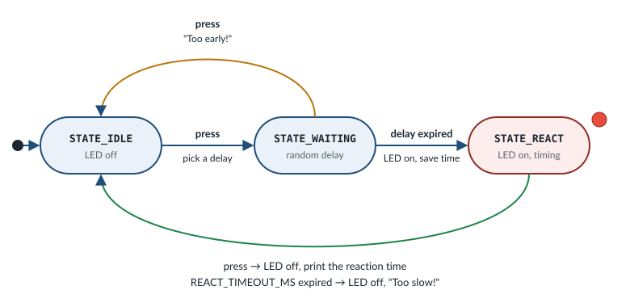

.. _exercise-reaction-game:

Exercise 5: Reaction Game
=========================

**Goal:** put everything together into a small game.

1. Press **SW2** to start a round.
2. After a **random** delay of 1 to 4 seconds, the red LED turns on.
3. Press SW2 as fast as you can. The reaction time is printed.

.. code-block:: none

   === Reaction Game ===

   Press SW2 to start round 1
   Get ready... press when the LED turns on!
     Reaction time: 243.118 ms

   Press SW2 to start round 2
   Get ready... press when the LED turns on!
     Too early! Wait for the LED.

**Concepts:** GPIO, interrupts, synchronization, timing, application state
management (state machines).

**What you work on:**

.. list-table::
   :widths: 30 70

   * - Application folder
     - ``zephyr/samples/workshop/reaction_game``

   * - File you edit
     - ``zephyr/samples/workshop/reaction_game/src/main.c``

   * - Solution
     - ``zephyr/samples/workshop/reaction_game/solution/src/main.c``

   * - Build command
     - ``west build -p -b frdm_mcxa156/mcxa156 zephyr/samples/workshop/reaction_game``

   * - Flash command
     - ``west flash``

.. include:: _include/before_you_start.rst

What the starter already does
-----------------------------

The game uses a common RTOS pattern:

- A GPIO **interrupt** fires when button SW2 is pressed. Zephyr then calls the
  callback ``button_pressed()``. It runs in interrupt context (inside an ISR,
  an interrupt service routine), so it must be short and must never wait.
- The ISR only records the event and puts it into a **message queue**, a
  thread-safe FIFO of fixed-size messages:
  ``k_msgq_put(&button_msgq, &evt, K_NO_WAIT)``. ``K_NO_WAIT`` means: never
  wait, which is required in an ISR.
- A **thread** waits for the messages with
  ``k_msgq_get(&button_msgq, &evt, timeout)`` and does the real work. The
  timeout ``K_FOREVER`` waits as long as it takes; ``K_MSEC(ms)`` waits at
  most ``ms`` milliseconds. ``k_msgq_get()`` returns ``0`` if a message
  arrived, and ``-EAGAIN`` if the time ran out.

The starter file already contains the hardware setup and the queue, so you
can focus on the game:

- ``led`` and ``button``: the red LED (alias ``led0``) and button SW2 (alias
  ``sw0``), both of type ``struct gpio_dt_spec``.
- ``struct button_event``, one message, with one field: ``cycles``, the value
  of the hardware cycle counter at the moment of the press.
- ``button_msgq``: the message queue, for up to 4 ``button_event`` messages.
- ``button_pressed()``: the callback. Its body is empty: you fill it in.
- ``setup_gpio()``: configures the LED and the button, enables the button
  interrupt on both edges (``GPIO_INT_EDGE_BOTH``, press and release) and
  registers ``button_pressed()``. ``main()`` already calls it.
- The timing constants (``MIN_DELAY_MS``, ``MAX_DELAY_MS``,
  ``REACT_TIMEOUT_MS``, ``DEBOUNCE_MS``), the ``enum game_state`` and the
  random number helpers ``rng_mix()`` and ``rng_next()``.

Design
------

The thread that receives the button events is the ``main()`` thread, which
runs the game as a **state machine**:

The same transitions as a table:

.. list-table::
   :header-rows: 1
   :widths: 20 20 20 40

   * - From
     - Event
     - To
     - Action

   * - ``STATE_IDLE``
     - press
     - ``STATE_WAITING``
     - LED off, pick a random delay

   * - ``STATE_WAITING``
     - press
     - ``STATE_IDLE``
     - "Too early!"

   * - ``STATE_WAITING``
     - delay expired
     - ``STATE_REACT``
     - LED on, remember the time

   * - ``STATE_REACT``
     - press
     - ``STATE_IDLE``
     - LED off, print the reaction time

   * - ``STATE_REACT``
     - ``REACT_TIMEOUT_MS`` expired
     - ``STATE_IDLE``
     - LED off, "Too slow!"

Things to notice:

- **Application state** lives in one variable, ``state``, owned by a single
  thread. Only the message queue is shared with the ISR, so there are no race
  conditions on the game data.
- **A timeout is an event too.** ``k_msgq_get(..., K_MSEC(delay))`` means
  "wait for a press, but at most ``delay`` ms". The return value tells you
  which one happened. One call implements both the random delay *and* the
  false-start detection.
- **Accurate timing.** The ISR stores ``k_cycle_get_32()``, the hardware cycle
  counter, at the moment of the press. The game thread may run a little later,
  but the timestamp is exact. ``k_cyc_to_us_floor32()`` converts cycles to
  microseconds.
- **Debouncing in the ISR.** A mechanical button *bounces* when you press and
  when you release it: several edges within a few milliseconds. In exercise 4
  the thread filtered them. This time the ISR does it: it sends a press only
  if there was no edge during the last ``DEBOUNCE_MS`` and the pin reads
  "pressed". That is one subtraction and one pin read, cheap enough for an
  ISR, and it keeps the game logic simple. It is the same rule as in
  exercise 4:

  .. image:: ../_static/images/exercises_debounce.svg
     :align: center
     :alt: Button signal for one press: a burst of bounce edges when pressed, a long time held down, and another burst when released, eight edges in total. Only edge 1 counts as a press: the button was quiet for 50 ms before it and the pin reads pressed. All other edges are ignored, either because they come less than 50 ms after the previous edge, or because the pin reads released.
- **Emptying the queue.** Presses that the player made at the wrong moment,
  for example while the game was printing, wait in the queue. The game would
  read them later and start a round on its own, or say "Too early!" for no
  reason. ``k_msgq_purge(&button_msgq)`` throws away all waiting messages.
  The game calls it at the start of ``STATE_IDLE`` and ``STATE_WAITING``, so
  that only presses made from that moment on count.
- **Random numbers.** The board configuration has no hardware entropy driver
  enabled, so the starter provides a tiny pseudo-random generator,
  ``rng_next()``. Seed it with ``rng_mix()`` using the timestamps of the
  player's button presses, which are unpredictable enough for a game.

.. admonition:: Zephyr |zephyr_version| reference
   :class: seealso

   - :zdoc:`Kernel timing <kernel/services/timing/clocks>`
   - :zapi:`System Clock APIs <clock__apis>` (``k_cycle_get_32()``, ``k_cyc_to_us_floor32()``, ``K_MSEC()``)
   - :zapi:`Message Queue APIs <msgq__apis>` (``k_msgq_get()``, ``k_msgq_purge()``)

Your tasks
----------

Open the starter file:

.. code-block:: bash

   code zephyr/samples/workshop/reaction_game/src/main.c

Besides the code described in `What the starter already does`_, it contains
comments named ``Step 1``, ``Step 2`` and ``Step 3 (bonus)``. Each step below
tells you where to add code. Don't delete the comments.

Build and flash after each step, to catch mistakes early:

.. code-block:: bash

   west build -p -b frdm_mcxa156/mcxa156 zephyr/samples/workshop/reaction_game
   west flash

Until all steps are done, the build may print warnings such as
``unused variable 'evt'``. That is expected. Errors (lines
with ``error:``) are not: fix them before you continue.

Step 1: the ISR
~~~~~~~~~~~~~~~

Go to the function ``button_pressed()``. Inside it, find the comment that
starts with ``Step 1:``. **Below** the end of that comment (the line with
``*/``), and above the closing ``}`` of the function, add:

1. A variable that remembers the time of the last edge, between calls
   (``static`` keeps its value):

   .. code-block:: c

      static uint32_t last_edge_cycles;

2. Read the cycle counter: ``uint32_t now = k_cycle_get_32();``.
3. Drop bounces and releases. Check whether the button was quiet for
   ``DEBOUNCE_MS``, then remember this edge, **also** when you ignore it.
   Return without doing anything if it was not quiet, or if the button does
   not read "pressed":

   .. code-block:: c

      bool quiet = k_cyc_to_ms_floor32(now - last_edge_cycles) >= DEBOUNCE_MS;

      last_edge_cycles = now;

      if (!quiet || gpio_pin_get_dt(&button) != 1) {
              return;
      }

4. Send the event:

   .. code-block:: c

      struct button_event evt = {
              .cycles = now,
      };

      k_msgq_put(&button_msgq, &evt, K_NO_WAIT);

.. admonition:: Zephyr |zephyr_version| reference
   :class: seealso

   - :zapi:`GPIO API <gpio__interface>` (``GPIO_INT_EDGE_BOTH``, ``gpio_pin_get_dt()``)

Step 2: the game loop
~~~~~~~~~~~~~~~~~~~~~

All of this goes into ``main()``.

1. **Variables.** At the start of ``main()``, above the line ``int ret;``,
   declare:

   .. code-block:: c

      enum game_state state = STATE_IDLE;
      struct button_event evt;
      uint32_t led_on_cycles = 0;
      uint32_t round_no = 1;

   ``evt`` receives the messages, ``led_on_cycles`` remembers when the LED
   turned on, and ``round_no`` counts the rounds. (Don't call it ``round``:
   that is already the name of a C math function.)

2. **The loop.** In ``main()``, find the comment that starts with
   ``Step 2:``. **Below** the end of that comment, and **above**
   ``return 0;``, write the loop. The comment shows its shape:

   .. code-block:: c

      while (1) {
              switch (state) {
              case STATE_IDLE:
                      /* a. */
                      break;

              case STATE_WAITING:
                      /* b. */
                      break;

              case STATE_REACT:
                      /* c. */
                      break;
              }
      }

   Now fill in the three cases.

   a. ``STATE_IDLE``: print ``"\nPress SW2 to start round %u\n"`` with
      ``round_no``. Empty the queue with ``k_msgq_purge(&button_msgq);``.
      Wait for a press with ``k_msgq_get(&button_msgq, &evt, K_FOREVER);``.
      Seed the random generator with ``rng_mix(evt.cycles);``. Set
      ``state = STATE_WAITING;``.

   b. ``STATE_WAITING``:

      - Pick a random delay. ``rng_next() % N`` gives a number from ``0`` to
        ``N - 1``, so:

        .. code-block:: c

           uint32_t delay_ms = MIN_DELAY_MS + rng_next() % (MAX_DELAY_MS - MIN_DELAY_MS);

        In C, a variable declared directly after a ``case`` label needs its
        own block. Write the case as ``case STATE_WAITING: {`` and put a
        ``}`` after its ``break;``.
      - Print ``"Get ready... press when the LED turns on!\n"`` and make sure
        the LED is off: ``gpio_pin_set_dt(&led, 0);``.
      - Empty the queue again: ``k_msgq_purge(&button_msgq);``. Only presses
        from now on may count as "too early".
      - Wait for a press, with the delay as timeout:
        ``k_msgq_get(&button_msgq, &evt, K_MSEC(delay_ms))``. If it returns
        ``0``, the player pressed too early: print
        ``"  Too early! Wait for the LED.\n"``, set ``state = STATE_IDLE;`` and
        ``break;``.
      - Otherwise the delay expired: turn the LED on
        (``gpio_pin_set_dt(&led, 1);``), save
        ``led_on_cycles = k_cycle_get_32();`` and set
        ``state = STATE_REACT;``.

   c. ``STATE_REACT``:

      - Wait for a press, with ``REACT_TIMEOUT_MS`` as timeout. Store the
        result: ``ret = k_msgq_get(&button_msgq, &evt, K_MSEC(REACT_TIMEOUT_MS));``.
      - Turn the LED off: ``gpio_pin_set_dt(&led, 0);``.
      - If ``ret == 0``, the player pressed. Compute the reaction time in
        microseconds from the two cycle counter values, and print it in
        milliseconds with three decimals:

        .. code-block:: c

           uint32_t reaction_us = k_cyc_to_us_floor32(evt.cycles - led_on_cycles);

           printk("  Reaction time: %u.%03u ms\n", reaction_us / 1000,
                  reaction_us % 1000);

        Then add 1 to ``round_no``.
      - Otherwise print ``"  Too slow! (more than %d ms)\n"`` with
        ``REACT_TIMEOUT_MS``.
      - Set ``state = STATE_IDLE;``.

3. Save, build and flash. Play a few rounds.

If you are stuck, the complete solution is in
``zephyr/samples/workshop/reaction_game/solution/src/main.c``.

.. note::

   Unsigned subtraction handles counter wrap-around: ``end - start`` is
   correct even if the 32-bit cycle counter overflowed in between, as long as
   less than one full counter period has passed.

Step 3 (bonus): statistics
~~~~~~~~~~~~~~~~~~~~~~~~~~

Find the comment that starts with ``Step 3 (bonus):``. You don't add code
below it: the code goes into the loop of step 2. Print the best and the
average reaction time after each round:

.. code-block:: none

     Reaction time: 243.118 ms
     New best!
     Rounds: 1, best: 243 ms, average: 243 ms

1. At the start of ``main()``, next to the other variables, add:

   .. code-block:: c

      uint32_t best_us = UINT32_MAX;
      uint64_t total_us = 0;

   ``UINT32_MAX`` is the largest possible value, so the first result is always
   a new best.

2. In ``STATE_REACT``, below the ``printk("  Reaction time: ...`` call and
   above ``round_no++;``, add:

   .. code-block:: c

      total_us += reaction_us;
      if (reaction_us < best_us) {
              best_us = reaction_us;
              printk("  New best!\n");
      }
      printk("  Rounds: %u, best: %u ms, average: %u ms\n", round_no,
             best_us / 1000, (uint32_t)(total_us / round_no / 1000));

3. Save, build and flash.

Ideas for extensions
--------------------

- **Best of 5:** play five rounds, then print a summary and reset the
  statistics.
- **Two players:** SW2 (alias ``sw0``) against SW3 (alias ``sw1``). Who presses
  first after the LED turns on? Use one message queue and put the button ID in
  the event.
- **Color feedback:** after a round, light the green LED (alias ``led1``) for
  a good time (below 250 ms) and the blue LED (alias ``led2``) otherwise.
- **Separate thread:** move the game into its own thread with
  ``K_THREAD_DEFINE``, and add a second thread that blinks the green LED
  (alias ``led1``) once per second.
- **Shell:** add ``CONFIG_SHELL=y`` to
  ``zephyr/samples/workshop/reaction_game/prj.conf`` and add a ``game stats``
  command. See ``zephyr/samples/subsys/shell/shell_module`` for an example.

.. admonition:: Zephyr |zephyr_version| reference
   :class: seealso

   - :zdoc:`Timers <kernel/services/timing/timers>`
   - :zdoc:`Shell <services/shell/index>`
   - :zkconfig:`CONFIG_SHELL`

Discussion
----------

- Why is the timestamp captured in the ISR and not in the thread?
- Which variables are accessed from both the ISR and a thread? Why is that
  safe here?
- What happens to button presses that arrive while the game is printing?
  What would happen without ``k_msgq_purge()``?

Start over
----------

To undo all your changes in ``zephyr/samples/workshop/reaction_game`` and get the original
files back, run these two commands in your work directory:

.. code-block:: bash

   git -C zephyr checkout -- samples/workshop/reaction_game
   git -C zephyr clean -fd -- samples/workshop/reaction_game

The first command restores the files that came with Zephyr. The second
one deletes the files that you **created** in that folder, for example an
overlay file.

.. warning::

   These commands cannot be undone. All your changes in
   ``zephyr/samples/workshop/reaction_game`` are lost, and the files you created there are
   deleted. If you want to keep your work, copy the folder somewhere else
   first.

.. include:: _include/troubleshooting.rst
