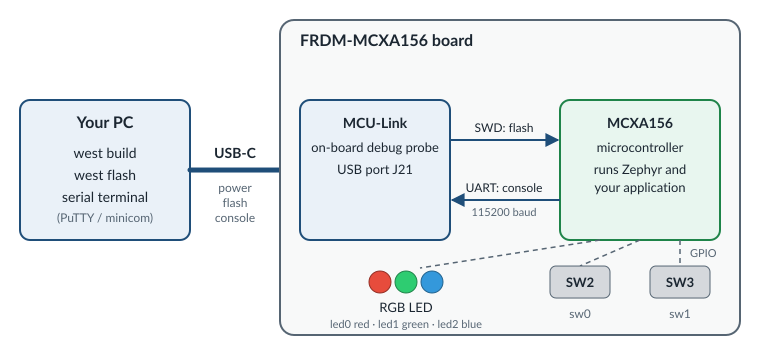

.. _exercises:

Introduction
============

In this workshop you go from "Hello World" to a small reaction-time game,
learning one core Zephyr concept per step. Each exercise builds on the
concepts of the previous one, so do them in order. But each exercise page is
complete on its own: it tells you how to set up, which files to open, what to
change and how to build. If you could not finish an exercise, you can still
start the next one.

.. list-table::
   :header-rows: 1
   :widths: 5 25 35 35

   * - #
     - Exercise
     - Sample
     - Main concepts

   * - 1
     - :doc:`Hello Zephyr <01_hello_world>`
     - ``zephyr/samples/hello_world``
     - Application structure, ``west``, board selection, build/flash, serial console

   * - 2
     - :doc:`Blinky <02_blinky>`
     - ``zephyr/samples/basic/blinky``
     - GPIO, Devicetree (``led0``, ``gpio_dt_spec``), Kconfig, device model

   * - 3
     - :doc:`Button + LED <03_button>`
     - ``zephyr/samples/workshop/button``
     - GPIO input, interrupts, callbacks, ISR context

   * - 4
     - :doc:`Threads <04_threads>`
     - ``zephyr/samples/workshop/threads``
     - Threads, priorities, message queues, blocking vs. non-blocking calls

   * - 5
     - :doc:`Reaction Game <05_reaction_game>`
     - ``zephyr/samples/workshop/reaction_game``
     - Timing, synchronization, state machines

Before you start, make sure you have completed the
:doc:`infrastructure setup <../infrastructure/index>` and that you can
:doc:`flash the board <../flashing_the_board>`.

How the exercises are organized
-------------------------------

The first two exercises use samples that come with Zephyr: ``hello_world`` and
``basic/blinky``. You read, build and modify them.

Exercises 3 to 5 live in ``zephyr/samples/workshop/``. Each of them is a
Zephyr application with a starter and a solution:

.. code-block:: none

   zephyr/samples/workshop/button/
   ├── CMakeLists.txt
   ├── prj.conf
   ├── src/
   │   └── main.c        <- you work here: hints in comments, little code
   └── solution/         <- a complete, working reference
       ├── CMakeLists.txt
       ├── prj.conf
       └── src/
           └── main.c

The starter in ``src/`` always builds, but it does almost nothing: its
comments, named ``Step 1``, ``Step 2``, ..., match the steps on the exercise
page. The starters of later exercises already contain the setup code you
wrote in earlier ones (for example the LED and button setup), so you only
write the code for the new concepts, and you don't need your own code from a
previous exercise.

The ``solution/`` folder is there in case you get stuck, or want to finish an
exercise at home. You can also build and flash the solution to see how the
result should behave:

.. code-block:: bash

   west build -p -b frdm_mcxa156/mcxa156 zephyr/samples/workshop/button/solution

Hardware
--------

All exercises run on the **FRDM-MCXA156** board, connected with a USB-C cable
to the **MCU-Link** USB port (J21). The cable provides power, the debug probe
and a serial port.

The exercises use these board features. The board's Devicetree gives them
standard names (*aliases*), so your code does not need to know the pin
numbers:

.. list-table::
   :header-rows: 1
   :widths: 20 40 40

   * - Alias
     - Board part
     - Pin

   * - ``led0``
     - RGB LED, red
     - P3_12

   * - ``led1``
     - RGB LED, green
     - P3_13

   * - ``led2``
     - RGB LED, blue
     - P3_0

   * - ``sw0``
     - Push button **SW2**
     - P1_7

   * - ``sw1``
     - Push button **SW3**
     - P0_6

   * - console
     - LPUART0 via MCU-Link
     - 115200 baud, 8N1

Everyday commands
-----------------

Run these from your work directory (``~/zephyr-workdir`` on Linux,
``~\Desktop\zephyr-workdir`` on Windows), with the virtual environment active.
Each exercise page explains how to get there in its *Before you start*
section.

.. code-block:: bash

   # Build. -p makes a pristine (clean) build.
   west build -p -b frdm_mcxa156/mcxa156 zephyr/samples/hello_world

   # Rebuild after changing the code (incremental build, much faster)
   west build

   # Flash the last build to the board
   west flash

   # Interactive Kconfig editor for the last build
   west build -t menuconfig

To see what the last build actually used, open these files in your editor,
for example with ``code build/zephyr/.config`` in VS Code:

- ``build/zephyr/.config``: the final Kconfig configuration
- ``build/zephyr/zephyr.dts``: the final, merged Devicetree

.. note::

   Use ``-p`` whenever you switch to a different application, for example from
   ``button`` to ``button/solution``. Without it, ``west build`` refuses to
   reuse a build directory that belongs to another application.

Useful documentation
--------------------

- `Zephyr documentation <https://docs.zephyrproject.org/latest/>`__
- `FRDM-MCXA156 board page <https://docs.zephyrproject.org/latest/boards/nxp/frdm_mcxa156/doc/index.html>`__
- `GPIO API <https://docs.zephyrproject.org/latest/hardware/peripherals/gpio.html>`__
- `Kernel services <https://docs.zephyrproject.org/latest/kernel/services/index.html>`__
