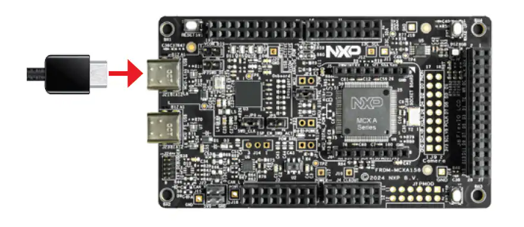

Flashing your Zephyr application
================================

This page describes the steps required for flashing your Zephyr application
on the **FRDM-MCXA156** board.

Prerequistes
------------

Before proceeding, make sure you go through the steps described in the following
pages:

- :doc:`Infrastructure getting started <infrastructure/index>`
- :doc:`Installing LinkServer <infrastructure/installing_linkserver>`

Flashing
--------

First, connect the FRDM-MCXA156 board to your host computer using the MCU-Link
USB port on the board (J21):

.. tabs::

   .. group-tab:: Linux

      After plugging in the board, you'll need to determine which USB port
      belongs to your board. To do so, run:

      .. code:: bash

         sudo dmesg -w

      And look for the following logs:

      .. image:: _static/images/board_linux_com.webp
         :align: center
         :scale: 40

      You'll need to find out the index of the **ttyACM** device. In the picture
      above, that would be **ttyACM0** (index 0).

      .. note::

         Depending on the USB connections of your host PC, the index of the USB
         device may differ!

      You can now open up a **minicom** session using the **ttyACM** device discovered
      earlier. To do so, open a new terminal session and run:

      .. code:: bash

         # replace the /dev/ttyACM0 device with your own if the index differs!
         sudo minicom -b 115200 -D /dev/ttyACM0 -8

      You'll be greeted by the following interface:

      .. image:: _static/images/minicom_linux_interface.webp
         :align: center
         :scale: 40

      .. note::

         While developing, you should keep the **minicom** window open.
         This way, you won't have to constantly open it and you'll avoid
         the possibility of missing logs from the board.

   .. group-tab:: Windows

      After plugging in the board, you'll need to determine which COM port
      belongs to your board. To do so, open **Device Manager** and look for
      the **Ports (COM & LPT)** tab:

      .. image:: _static/images/windows_device_manager.webp
         :align: center
         :scale: 40

      If you click on it, you should see an entry called **MCU-Link VCom Port (COMx)**
      (x is an index, which might vary depending on what USB devices are connected to
      your host PC):

      .. image:: _static/images/windows_device_manager_com_port.webp
         :align: center
         :scale: 40

      In this particular case, the COM port used to communicate with the board is **COM3**.
      You can now use this to open up a **puTTY** session. To do so:

      1. Open up **puTTY**.

         .. image:: _static/images/windows_opening_putty.webp
            :align: center
            :scale: 40

      2. Select the **Serial** connection type.

         .. image:: _static/images/windows_putty_serial.webp
            :align: center
            :scale: 40

      3. Set the speed to **115200**.

         .. image:: _static/images/windows_putty_serial_speed.webp
            :align: center
            :scale: 40

      4. Type in the name of your COM device (using the **Serial line** text box) and
         the click **Open**.

         .. image:: _static/images/windows_putty_serial_device.webp
            :align: center
            :scale: 40

      You'll be greeted by the following interface:

      .. image:: _static/images/windows_putty_interface.webp
         :align: center
         :scale: 40

To flash your application, you'll first have to build it. Using **hello_world**
as an example, you can do so by running:

.. code:: bash

   # make sure you're in zephyr-workdir before running this!
   west build -p -b frdm_mcxa156/mcxa156 zephyr/samples/hello_world

You can now flash the application by running:

.. code:: bash

   west flash

.. warning::

   For Windows hosts, make sure you run

   .. parsed-literal::

      |linkserver_path_cmd|

   before this!

If everything went well, you should see some output in your serial console:

.. tabs::

   .. group-tab:: Linux

      .. image:: _static/images/minicom_linux_hello_world.webp
         :align: center
         :scale: 40

   .. group-tab:: Windows

      .. image:: _static/images/putty_windows_hello_world.webp
         :align: center
         :scale: 40
