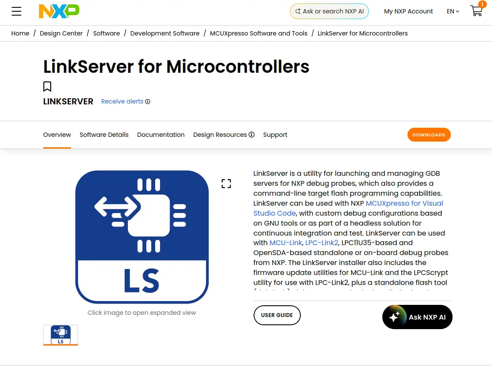

LinkServer
==========

About
-----

LinkServer [#]_ is an application provided by NXP, which allows you to
connect to the MCU-Link debug probes found on various NXP MCUs. In the
context of this workshop, its main usage is to allow flashing Zephyr
applications to the board.

To get started with LinkServer, go to the `landing page`_:

.. note::

   Installing LinkServer may require creating an account on nxp.com!

Installation
------------

.. tabs::

   .. group-tab:: Linux

      Scroll down until you find the **Downloads** section and then download
      the Linux installer:

      .. image:: ../_static/images/linkserver_linux_download.webp
         :align: center
         :scale: 40

      .. note::

         You'll need to accept the EULA before downloading the installer.

      You should now have **LinkServer_26.9.130.x86_64.deb.bin** in your **Downloads** folder.
      To execute it:

      .. code:: bash

         cd ~/Downloads
         chmod +x LinkServer_26.9.130.x86_64.deb.bin
         # you'll need sudo for this!
         sudo ./LinkServer_26.9.130.x86_64.deb.bin

      After executing the binary, you'll be greeted with the following EULA:

      .. image:: ../_static/images/linkserver_linux_eula.webp
         :align: center
         :scale: 40

      To accept it, use the left and right arrow keys plus the ENTER key. Afterwards,
      you'll be asked if you want to continue. To accept, type Y in your terminal window
      and press ENTER:

      .. image:: ../_static/images/linkserver_linux_continue.webp
         :align: center
         :scale: 40

      If everything went well, you should now have LinkServer installed on your PC.
      To find out where it was installed, look at the installation logs:

      .. image:: ../_static/images/linkserver_linux_install_location.webp
         :align: center
         :scale: 40

      In this particular case, LinkServer was installed in **/usr/local/LinkServer**.
      The next step is to add LinkServer to your **PATH**. To do so:

      .. code:: bash

         export PATH=$PATH:/usr/local/LinkServer

      .. warning::

         You'll have to run the command above each time you open a new terminal session.
         To make the change persistent:

         .. code:: bash

            echo "export PATH=\$PATH:/usr/local/LinkServer" >> ~/.bashrc

   .. group-tab:: Windows

      Scroll down until you find the **Downloads** section and then download
      the Windows installer:

      .. image:: ../_static/images/linkserver_windows_download.webp
         :align: center
         :scale: 40

      .. note::

         You'll need to accept the EULA before downloading the installer.

      You should now have **LinkServer_26.9.130.exe** in your **Downloads** folder.
      Double-click to execute it and go through all installation steps (you can just
      keep clicking **Next** until the package is installed).

      .. note::

         Make sure to de-select **Associate with MCUXpresso IDE installations** near
         the end. If you forget to do so by accident, then just close the window that'll
         pop out at the end.

      .. warning::

         By default, LinkServer will not be added to your PATH. To do so, run:

            .. code:: powershell

               $env:Path += ";C:\NXP\LinkServer_26.9.130"

         This change is not persistent. You'll have to do it each time you open a new
         PowerShell session!

With this, LinkServer should be ready to be used! You can now proceed to the
next step which is :doc:`flashing your Zephyr application <../flashing_the_board>`.

.. [#] https://www.nxp.com/design/design-center/software/development-software/mcuxpresso-software-and-tools-/linkserver-for-microcontrollers:LINKSERVER

.. _landing page: https://www.nxp.com/design/design-center/software/development-software/mcuxpresso-software-and-tools-/linkserver-for-microcontrollers:LINKSERVER
