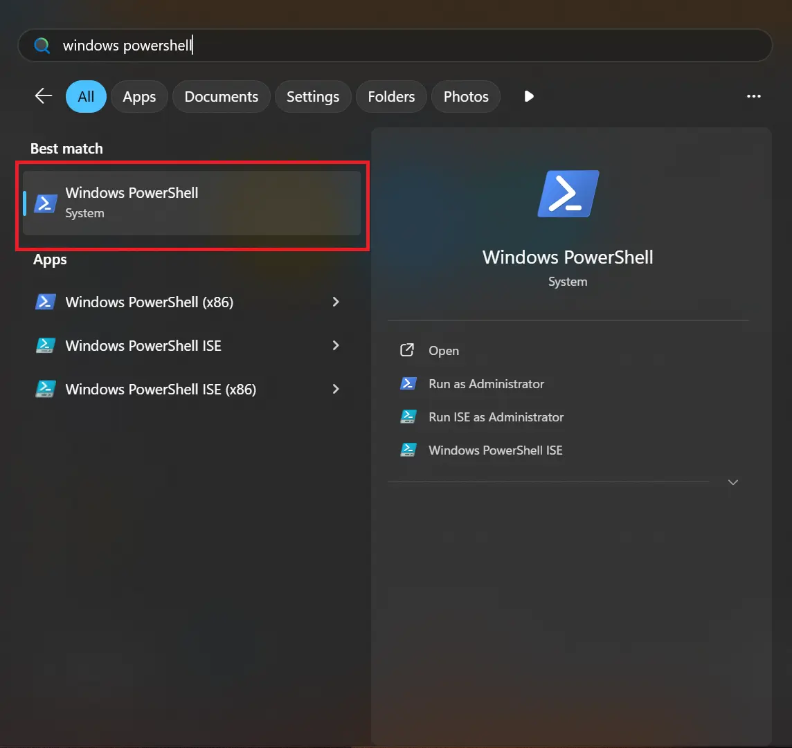
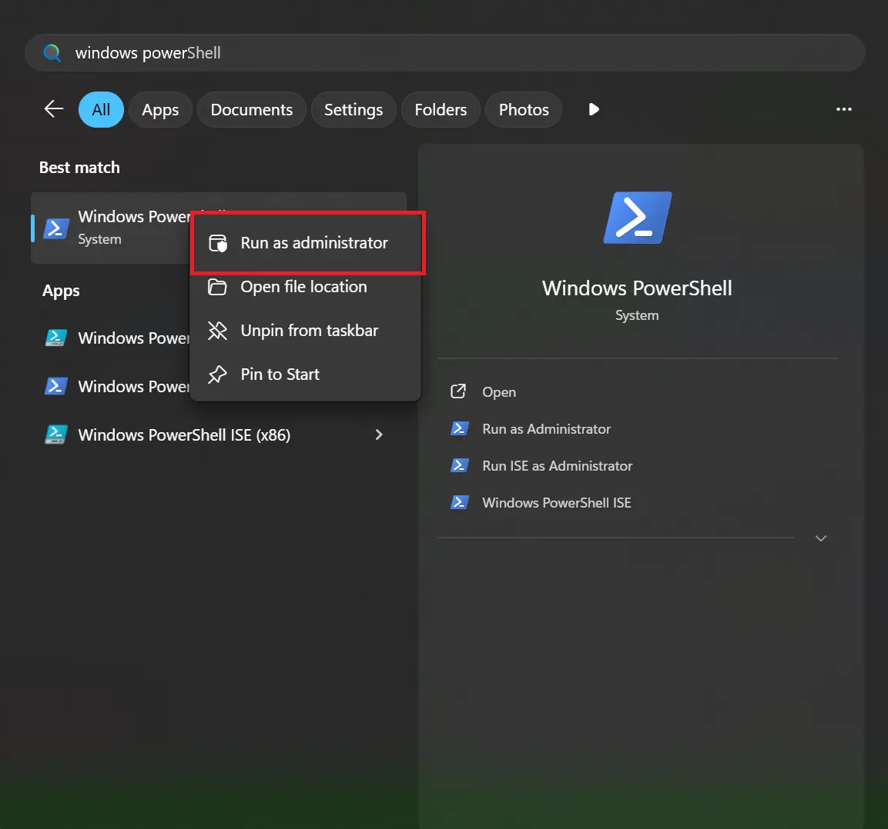
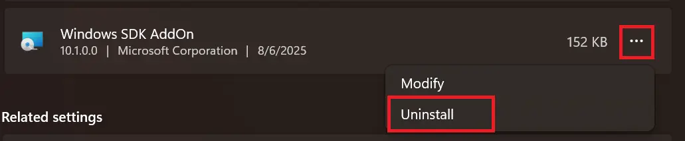

.. _windows-setup:

Windows setup guide
===================

This page describes the steps required for setting up the development
infrastructure on a Windows-based machine.

.. warning::

   It is assumed your machine is running **Windows 11**.

.. warning::

   It is assumed that your machine already has **winget**. This executable
   should already be shipped with your OS.

Using PowerShell
----------------

This guide assumes you're using **PowerShell**. To open a PowerShell terminal:

1. Open the **Start** menu by pressing on the **Win** key.
2. Type in **windows powershell**
3. Click on the highlighted area:

Changing PowerShell's execution policy
~~~~~~~~~~~~~~~~~~~~~~~~~~~~~~~~~~~~~~

To protect users against running malicious code, PowerShell comes with
a mechanism which prevents users from running scripts that don't meet
certain conditions. For more details, you can read this `article`_.

Since we'll need to run the setup script later on, we need to make sure that
the PowerShell policy is relaxed enough to allow this. To do so, you'll need to:

1. Open a PowerShell terminal with administrator rights:

2. Run:

.. code:: powershell

   Set-ExecutionPolicy -ExecutionPolicy Unrestricted

.. note::

   This command sets the execution policy for the LocalMachine scope,
   which is why it requires admin rights.

   You can also choose to set the execution policy for the CurrentUser
   scope, which will remove the need for admin rights.

   After executing the command, PowerShell may ask you to acknowledge
   the change.

   You can choose whatever execution policy you see fit as long as it’s
   relaxed enough to allow the execution of the setup script.

To check if the execution policy was changed, run:

.. code:: powershell

   Get-ExecutionPolicy

.. warning::

   The execution policy has multiple scopes (e.g. LocalMahine, CurrentUser etc.),
   some of which may take precedence over the LocalMachine scope. If the policy
   was not changed after using **Set-ExecutionPolicy**, you'll have to make sure
   that scopes with higher precedence are not currently using a more restrictive
   policy.

   For more details, you can read this `article`_.

Installing dependencies
-----------------------

To install the required packages, run:

.. code:: powershell

   winget install --id Git.Git python

.. note::

   After installing **python**, please run ``python --version`` to make
   sure that PATH was updated accordingly and that the installed python
   version is 3.10 or newer.

   If the command doesn't work, try closing the PowerShell terminal and
   opening a new one to force a reload of the PATH variable.

Cloning the repository
----------------------

Before cloning the workshop repository, make sure you create a work directory:

.. code:: powershell

   New-Item -Path "~\Desktop\" -Name "zephyr-workdir" -Type "Directory"
   cd ~\Desktop\zephyr-workdir

.. warning::

   Make sure that the work directory path doesn't contain any whitespaces,
   otherwise the sample build step may fail. For instance, paths such as:
   ``C:\Users\TEST USER\Desktop\zephyr-workdir`` should be avoided.

   You are not allowed to change the location of the work directory after
   running the setup script, otherwise your packages won't work properly.

To clone the repository:

.. code:: powershell

   git clone https://github.com/NXP-Research/zs-main.git && cd zs-main

Running the setup script
------------------------

.. admonition:: For PowerShell 5.1 users

   Powershell 5.1 creates an alias for the ``wget`` Linux command,
   defining it as ``Invoke-WebRequest``. Because of this, trying to invoke
   ``wget`` with the options you'd normally use on a Linux-based system will
   fail since those options are not recognized by ``Invoke-WebRequest``.

   The setup script needs ``wget`` to download the toolchain and, therefore,
   if the alias is not removed, it will not function properly.

   To remove the alias in the current terminal session, you can run:
   ``Remove-Item Alias:wget``. This change, however, will not be persistent.
   If you open a new terminal, you'll notice that the alias is still defined.

   To make the change persistent, run:``notepad $PROFILE`` and then add
   ``Remove-Item Alias:wget -ErrorAction SilentlyContinue`` to the file.
   Once you're done, close the current terminal and open a new one.

   To check if the alias is defined, run: ``Get-Alias wget``. If the alias
   is not defined, the command will fail.

To run the setup script:

.. code:: powershell

   Remove-Item Alias:wget # for PowerShell 5.1 users, see note above
   .\scripts\setup.ps1

.. note::

   While running, the script may ask you to accept the installation of
   certain packages.

Activating the virtual environment
----------------------------------

Before starting the development process, make sure you activate the python
virtual environment created by the **setup.ps1** script. To do so, run:

.. code:: powershell

   ~\Desktop\zephyr-workdir\zephyr-workshop\ENV\Scripts\Activate.ps1

.. warning::

   You need to re-do this setp each time you open a new PowerShell session!

To check if the virtual environment has been activated, you can look at
your powershell prompt:

.. code:: powershell

   (ENV) PS C:\Users\LMC\Desktop\zephyr-workdir\

If you're missing the **(ENV)** bit, that means the virtual environment is
**NOT** active.

Validating your development environment
---------------------------------------

To make sure your environment is prepared for development, you can try to
build the **hello_world** Zephyr sample:

.. code:: bash

   # make sure you're always in ~\Desktop\zephyr-workdir when developing!
   cd ~\Desktop\zephyr-workdir

   west build -p -b frdm_mcxa156/mcxa156 zs-zephyr/samples/hello_world

If the **west** command succeeds, that means you're ready for development!
You can now proceed to the next step, which is :doc:`installing LinkServer <installing_linkserver>`.

Uninstalling packages
---------------------

.. warning::

   **DO NOT** manually delete the packages under ``packages`` otherwise
   you risk messing up your PATH variable. These will be automatically
   removed if you use one of the uninstall methods specified below.

Once you're permanently done with the development, you may want to delete
all of the previously installed packages. To do so, you can either:

.. code-block:: powershell

   winget uninstall --id <package_name>

or:

1. Go to ``Apps > Installed apps``.
2. Find the application you want to delete.
3. Click on ``...`` and then ``Uninstall``:

.. _article: https://learn.microsoft.com/en-us/powershell/module/microsoft.powershell.core/about/about_execution_policies?view=powershell-7.5
